# Aksara - Backend NestJS & Integrasi Fullstack (Tugas BAB 9)

Aplikasi manajemen tugas kuliah fullstack dengan arsitektur MVC menggunakan NestJS di sisi backend dan React + Vite di sisi frontend.

## 1. Data Utama Aplikasi
- **Entitas:** `Tugas`
- **Field & Tipe Data:**
  - `id` (number): Identifikasi unik tugas
  - `judul` (string): Nama atau judul tugas (minimal 3 karakter)
  - `mataKuliah` (string): Nama mata kuliah terkait (minimal 3 karakter)
  - `deadline` (string): Tanggal batas waktu pengumpulan
  - `status` (string): Status pengerjaan (`Belum Dikerjakan`, `Sedang Dikerjakan`, `Selesai`)
  - `prioritas` (string): Tingkat prioritas (`Rendah`, `Sedang`, `Tinggi`)
  - `estimasiJam` (number): Estimasi durasi pengerjaan dalam jam
  - `sudahSelesai` (boolean): Flag penanda tugas selesai

## 2. Struktur MVC Backend (NestJS)
- **Model / Entity (`backend/src/tugas/entities/tugas.entity.ts`):** Merepresentasikan struktur data tugas.
- **Service (`backend/src/tugas/tugas.service.ts`):** Mengelola logika bisnis dan operasi CRUD yang disimpan dalam array memori:
  - `create(createTugasDto)`
  - `findAll()`
  - `findOne(id)`
  - `update(id, updateTugasDto)`
  - `remove(id)`
- **Controller (`backend/src/tugas/tugas.controller.ts`):** Menangani routing HTTP (`GET`, `POST`, `PATCH`, `DELETE`) dan memanggil service melalui dependency injection.
- **DTO & Validasi (`backend/src/tugas/dto/`):**
  - `CreateTugasDto`: Menggunakan `class-validator` (`@IsString`, `@IsNotEmpty`, `@MinLength`, `@IsIn`, `@IsInt`, `@Min`, `@IsBoolean`, `@IsOptional`).
  - `UpdateTugasDto`: Menggunakan `PartialType(CreateTugasDto)`.
  - `ValidationPipe`: Diaktifkan secara global di `backend/src/main.ts` dengan opsi `whitelist`, `forbidNonWhitelisted`, dan `transform`.

## 3. Penanganan Error (Exception NestJS)
1. **`ConflictException` (HTTP 409):** Dilempar ketika menambahkan tugas dengan judul yang sama pada mata kuliah yang sama.
2. **`NotFoundException` (HTTP 404):** Dilempar saat pencarian, pembaruan, atau penghapusan data dengan ID yang tidak ditemukan.

## 4. Pengujian REST Client
File pengujian: `backend/tugas.http`.

| No | Endpoint | Method | Keterangan | Status Code | Screenshot |
|---|---|---|---|---|---|
| 1 | `/tugas` | GET | Mengambil seluruh data tugas | 200 OK | 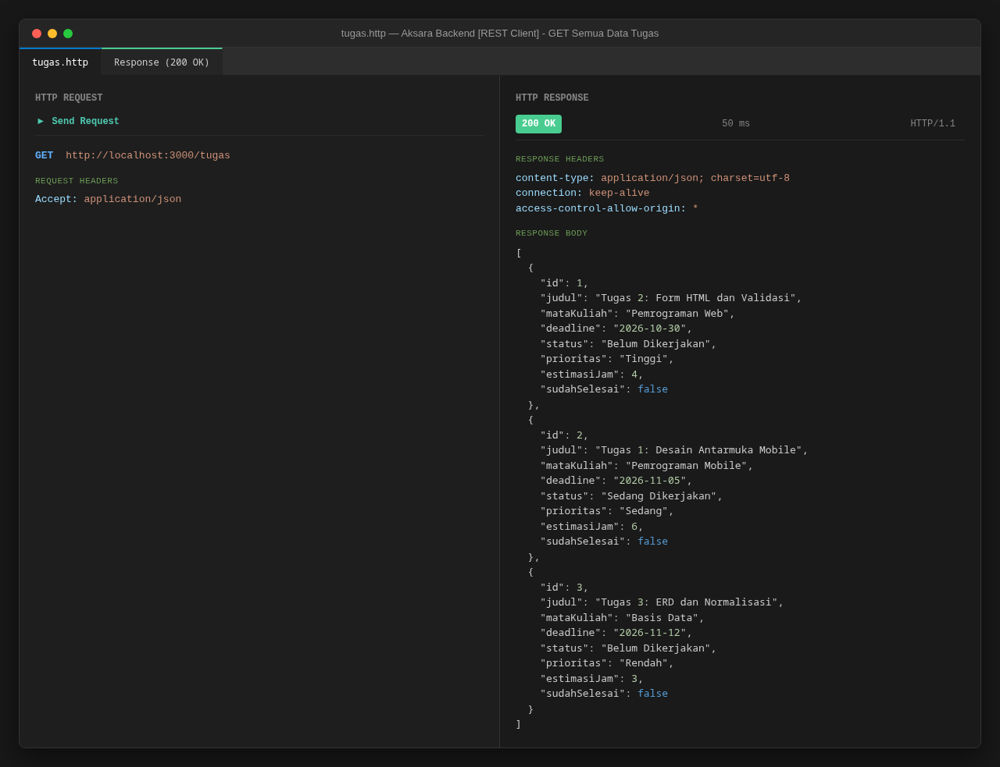 |
| 2 | `/tugas/1` | GET | Mengambil data tugas spesifik | 200 OK | 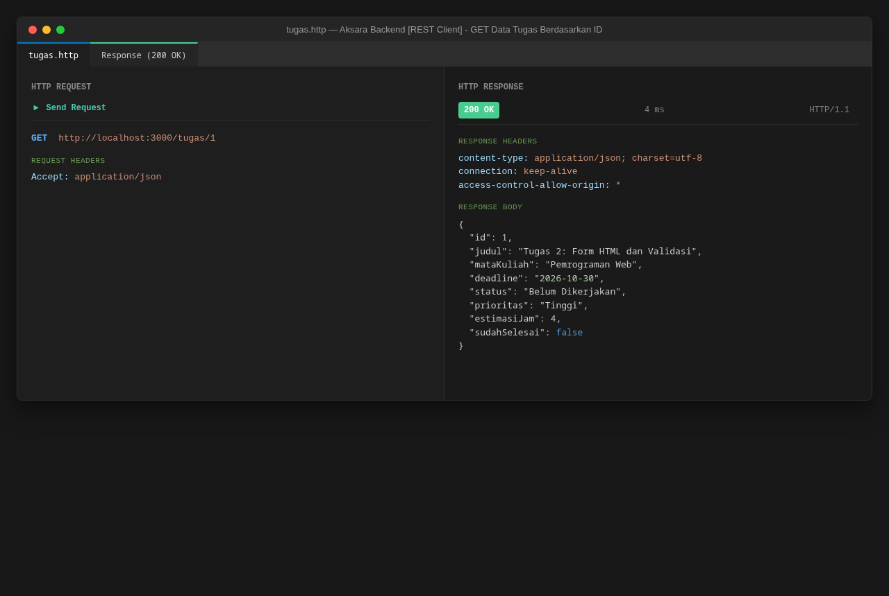 |
| 3 | `/tugas` | POST | Menambahkan data tugas baru | 201 Created | 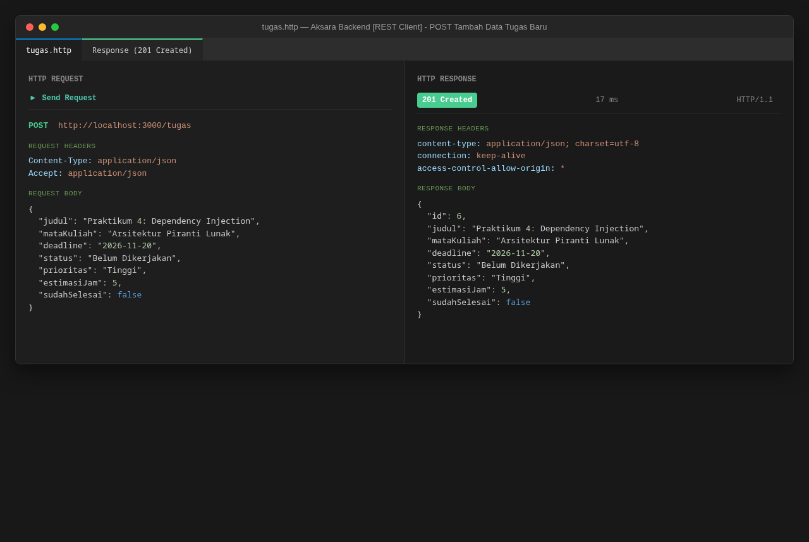 |
| 4 | `/tugas` | POST | Error duplikasi data (ConflictException) | 409 Conflict | 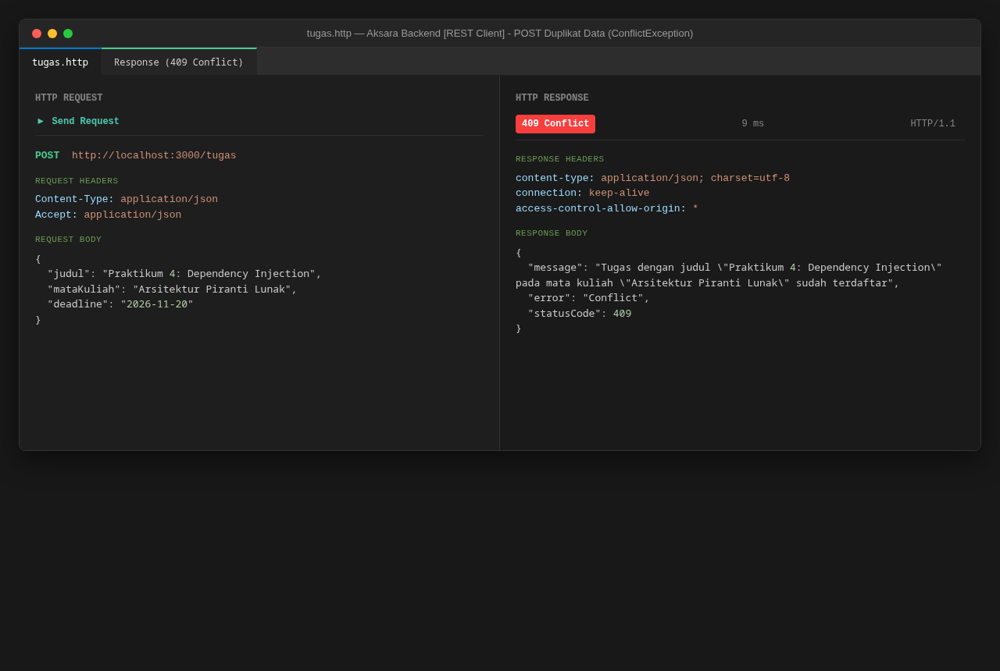 |
| 5 | `/tugas` | POST | Error validasi class-validator | 400 Bad Request | 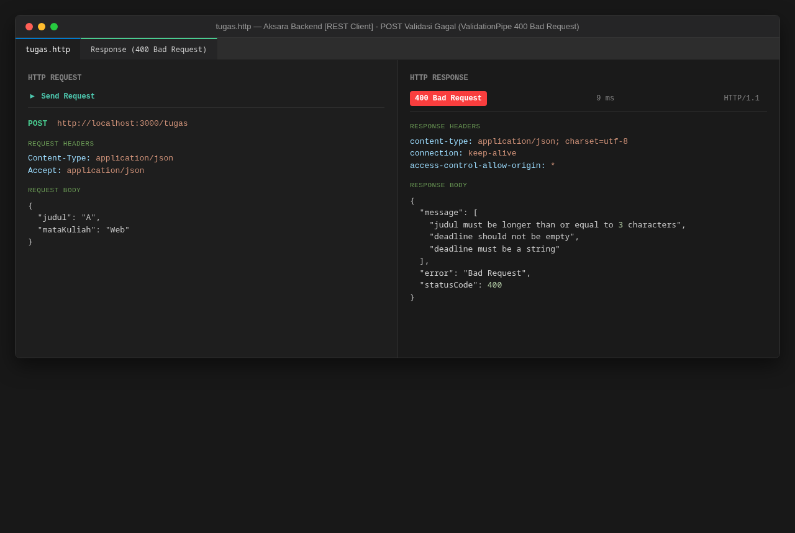 |
| 6 | `/tugas/999` | GET | Error ID tidak ditemukan (NotFoundException) | 404 Not Found | 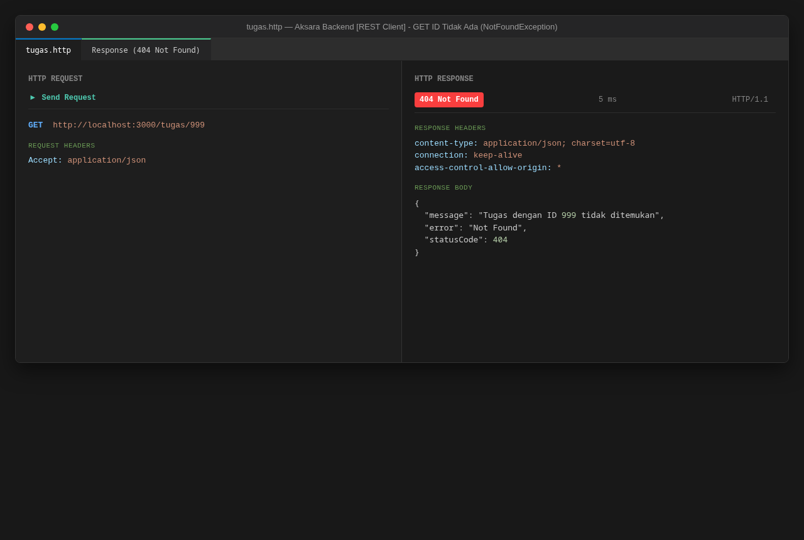 |
| 7 | `/tugas/4` | PATCH | Memperbarui status / data tugas | 200 OK | 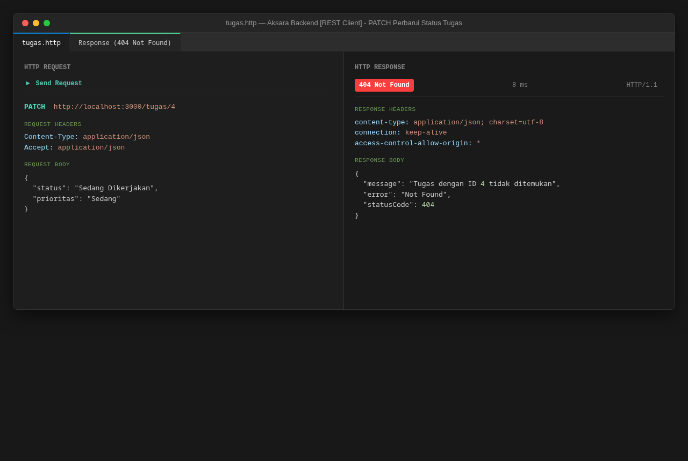 |
| 8 | `/tugas/4` | DELETE | Menghapus data tugas | 200 OK | 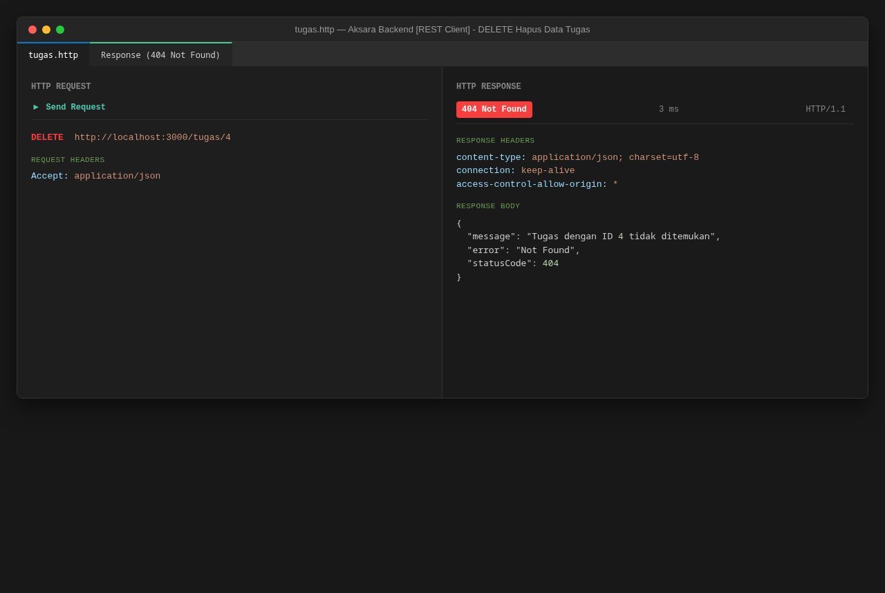 |

## 5. Integrasi Frontend - Backend
Alur CRUD penuh terhubung antara frontend React dan backend NestJS:

1. **Tampilan Awal (GET):** Data tugas dimuat langsung dari endpoint `GET /tugas` pada backend.
   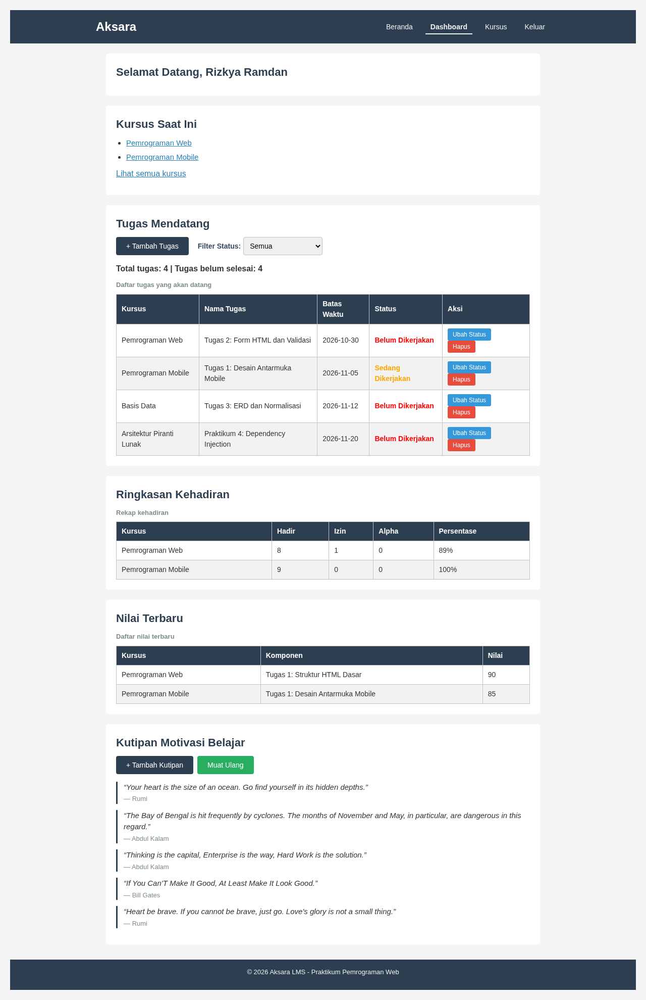

2. **Buka Form Tambah Tugas:** Menampilkan input form penambahan tugas.
   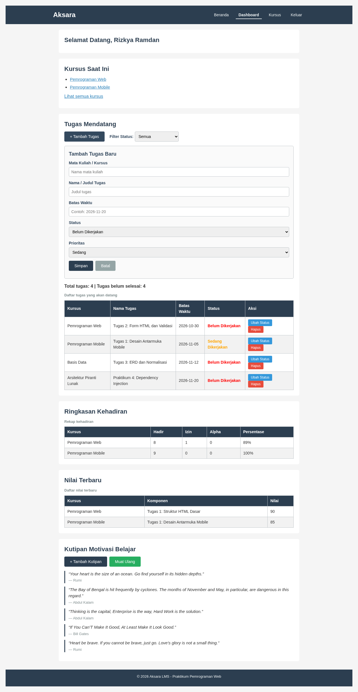

3. **Menambah Data (POST):** Data dikirim melalui method POST ke backend dan daftar tabel diperbarui.
   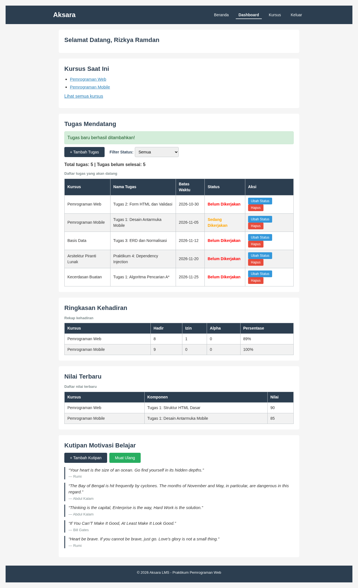

4. **Mengubah Data (PATCH):** Mengubah status tugas melalui method PATCH ke backend.
   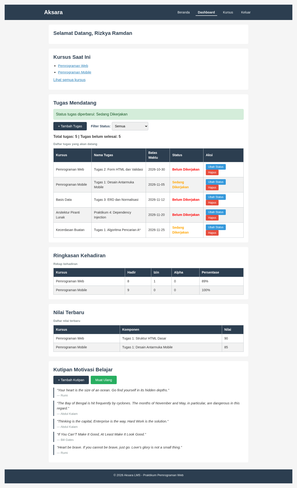

5. **Menghapus Data (DELETE):** Menghapus data tugas melalui method DELETE ke backend.
   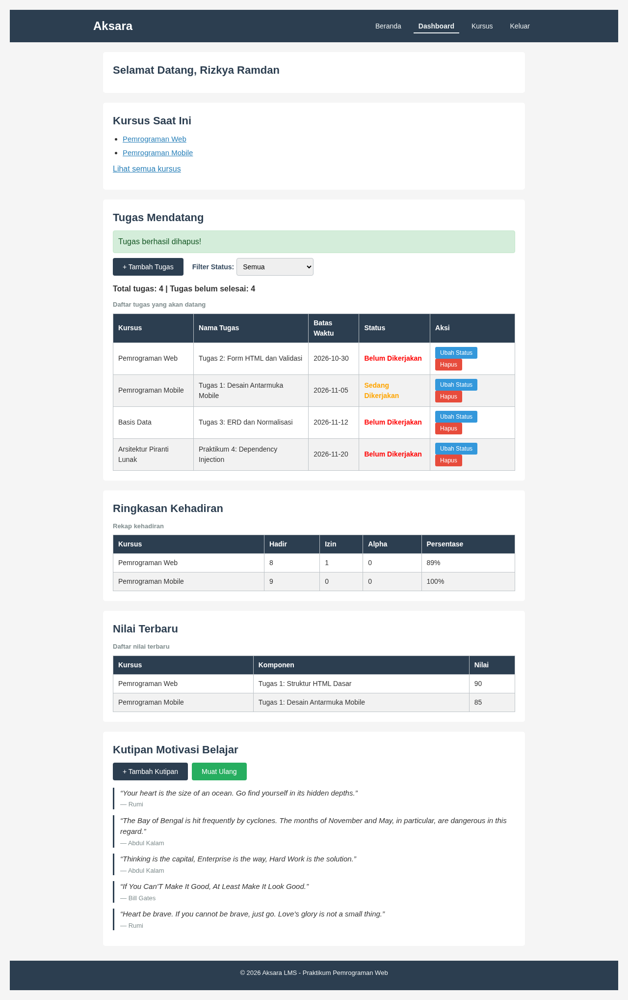

## Cara Menjalankan

### Backend (NestJS)
```bash
cd backend
npm install
npm run start:dev
```
Backend berjalan pada `http://localhost:3000`.

### Frontend (React + Vite)
```bash
npm install
npm run dev
```
Frontend berjalan pada `http://localhost:5173`.
