# Aksara - REST API + PostgreSQL + Prisma ORM (Tugas BAB 10)

Aplikasi manajemen tugas kuliah fullstack dengan arsitektur MVC menggunakan NestJS di sisi backend, PostgreSQL sebagai sistem basis data relasional melalui Prisma ORM, dan React + Vite di sisi frontend.

---

## 1. Entitas & Model Prisma

Model utama dirancang pada `backend/prisma/schema.prisma`:

| Field | Tipe Data | Deskripsi | Default |
|---|---|---|---|
| `id` | Int | Identifier unik (Primary Key) | `autoincrement()` |
| `judul` | String | Judul atau nama tugas | - |
| `mataKuliah` | String | Nama mata kuliah terkait | - |
| `deadline` | String | Batas waktu pengumpulan tugas | - |
| `status` | String | Status pengerjaan tugas | `"Belum Dikerjakan"` |
| `prioritas` | String | Tingkat prioritas tugas | `"Sedang"` |
| `estimasiJam` | Int | Estimasi durasi pengerjaan (jam) | `2` |
| `sudahSelesai` | Boolean | Indikator penyelesaian tugas | `false` |

---

## 2. Tahapan Implementasi & Dokumentasi Screenshot

### Tahap 1: Persiapan Server PostgreSQL & Basis Data
Server PostgreSQL lokal disiapkan pada port `5432` dan basis data `aksara_db` berhasil dibuat.

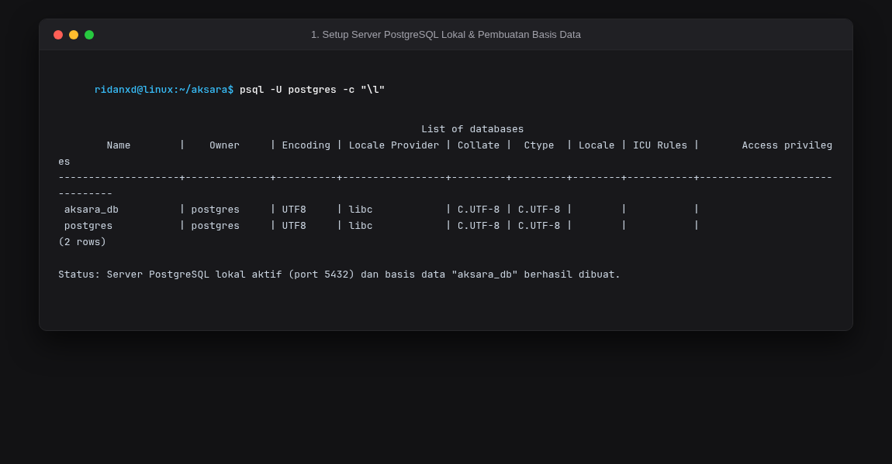

---

### Tahap 2: Perancangan Model Prisma (`schema.prisma`)
Model entitas `Tugas` didefinisikan pada `schema.prisma` yang dipetakan ke tabel relasional `tugas`.

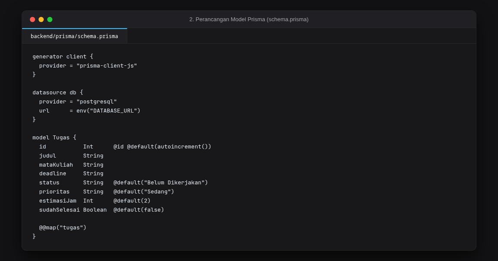

---

### Tahap 3: Migrasi Basis Data (`npx prisma migrate dev`)
Migrasi awal dijalankan untuk menerapkan skema ke PostgreSQL dan tabel `tugas` berhasil terbentuk.

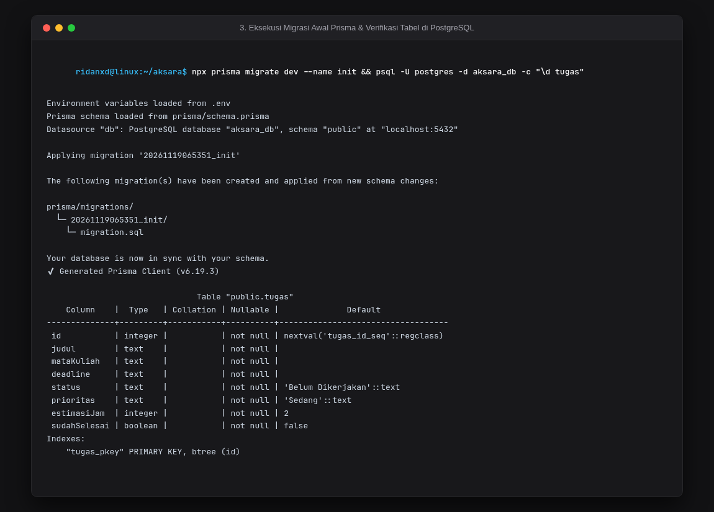

---

### Tahap 4: PrismaService Provider & Integrasi Service
`PrismaService` dibuat sebagai injectable provider yang memperluas `PrismaClient` dan diintegrasikan ke `TugasService` menggantikan penyimpanan array memori.

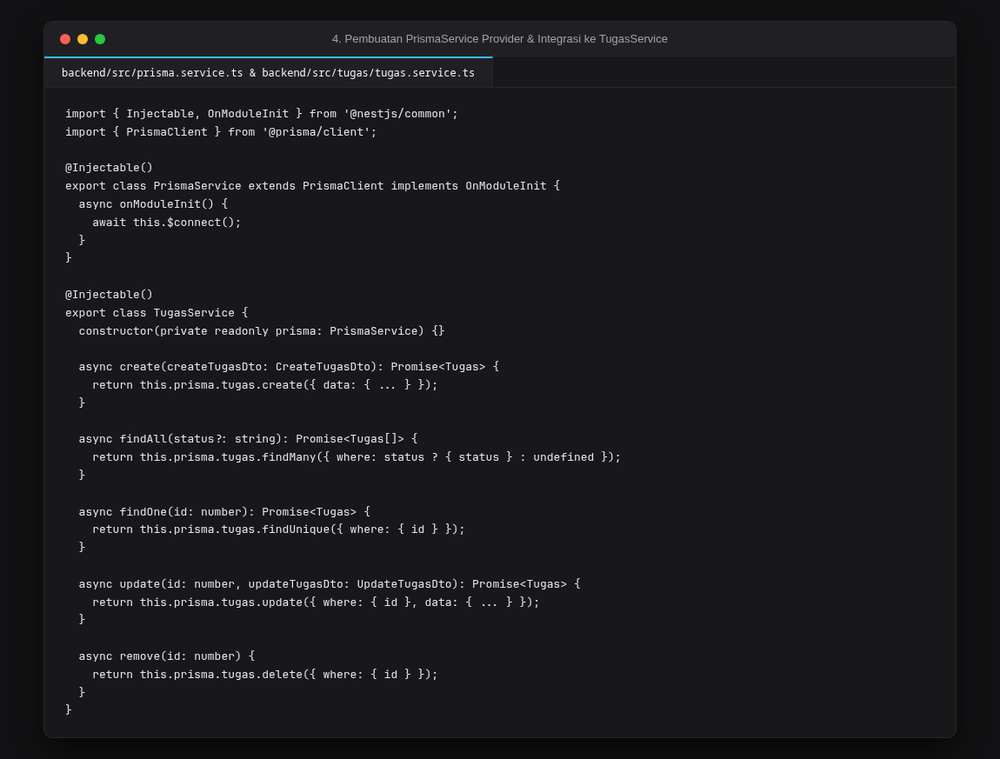

---

### Tahap 5: Pengujian Operasi CRUD Permanen

#### a. GET All Tugas
Mengambil seluruh data tugas yang tersimpan permanen di database PostgreSQL.

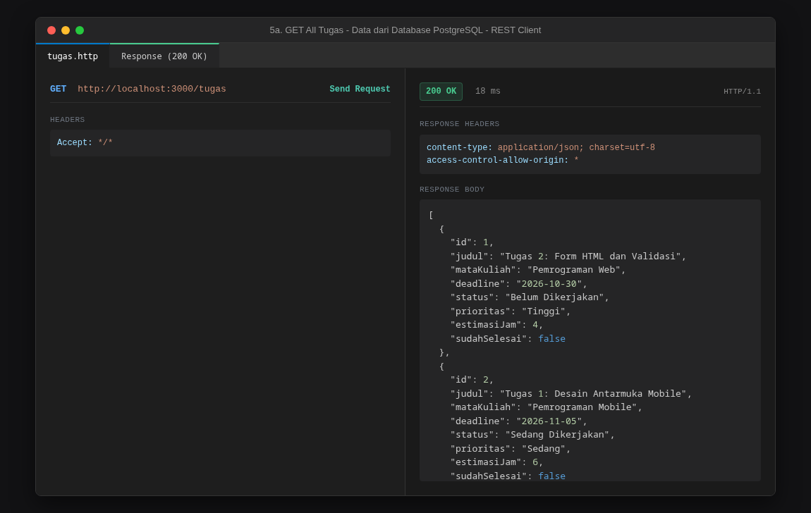

#### b. GET Tugas by ID
Mengambil data tugas spesifik berdasarkan parameter ID.

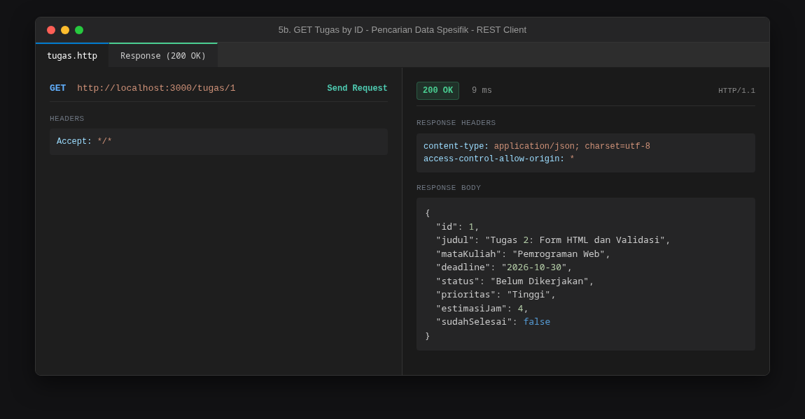

#### c. POST Create Tugas
Menambahkan data tugas baru ke database dengan status code `201 Created`.

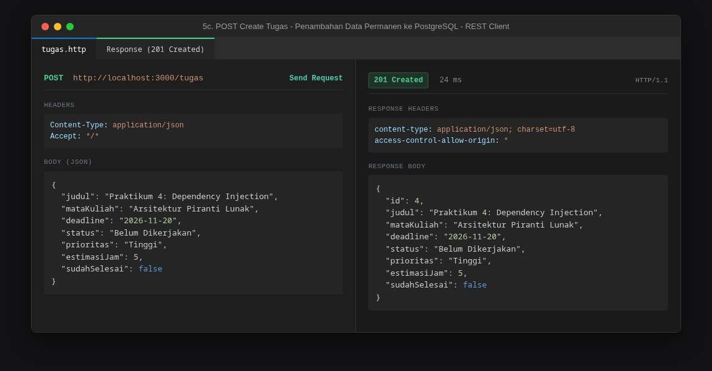

#### d. POST Conflict Exception (Duplikasi Data)
Validasi penolakan penambahan tugas duplikat dengan status code `409 Conflict`.

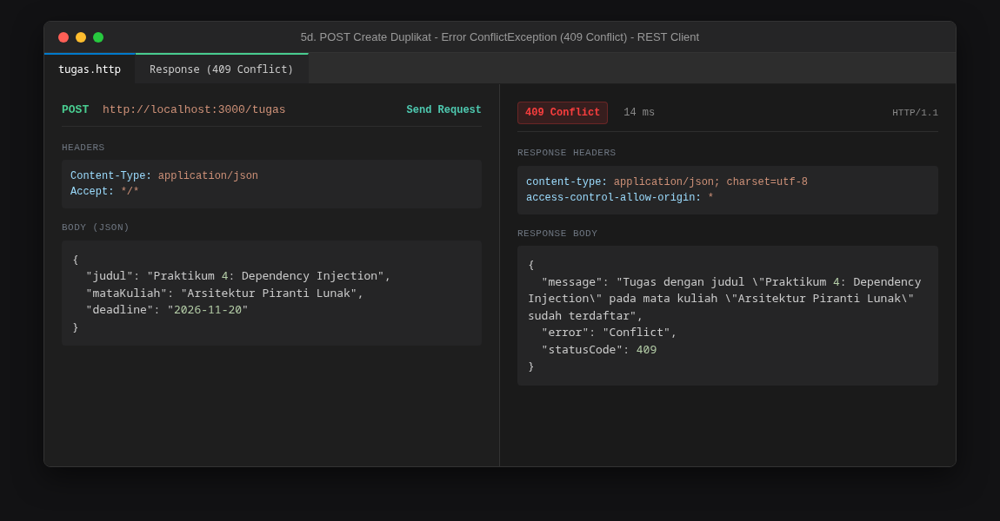

#### e. PATCH Update Tugas
Memperbarui data dan status tugas di PostgreSQL dengan status code `200 OK`.

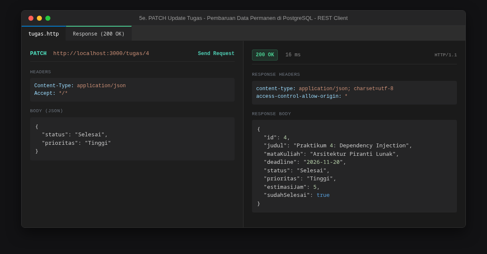

#### f. DELETE Tugas
Menghapus data tugas dari PostgreSQL dengan status code `200 OK`.

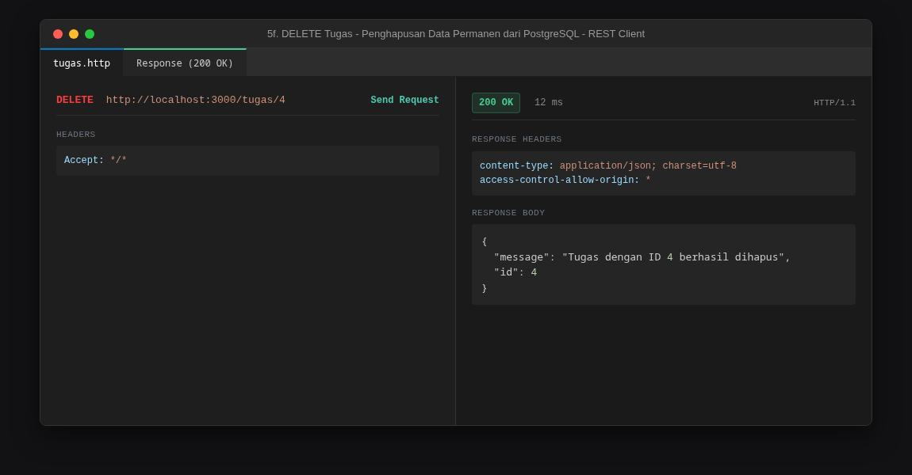

---

### Tahap 6: Query Lanjutan (Filter WHERE & Statistik COUNT)

#### a. Filter Data (`WHERE` via Query Parameter)
Endpoint: `GET /tugas?status=Belum%20Dikerjakan`  
Memfilter daftar tugas menggunakan klausa `where` pada Prisma Client.

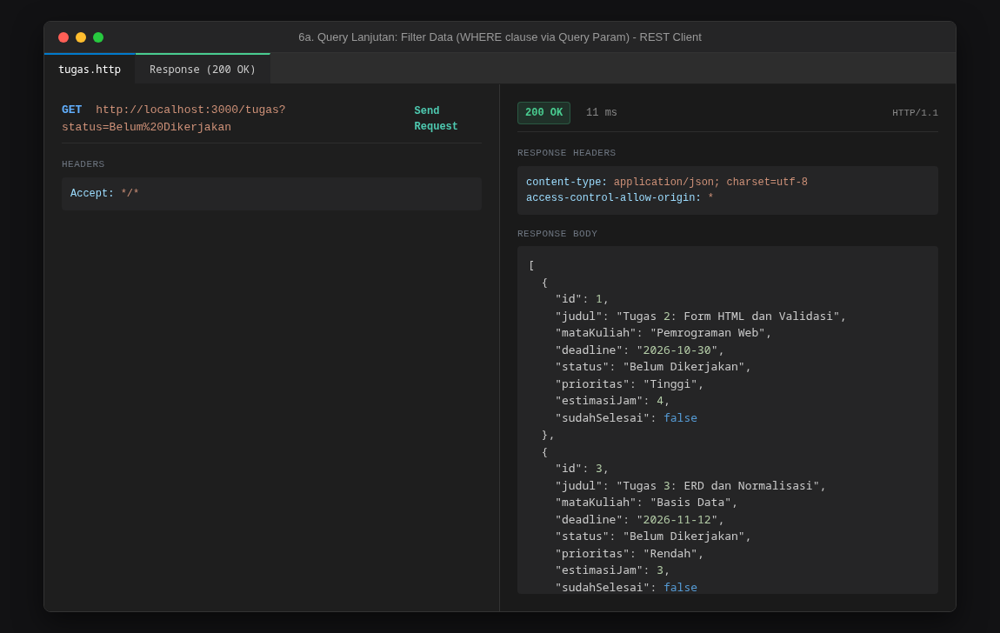

#### b. Statistik Sederhana (`COUNT` Aggregation)
Endpoint: `GET /tugas/statistik`  
Menghitung ringkasan jumlah tugas (total, selesai, sedang dikerjakan, belum dikerjakan) menggunakan `prisma.tugas.count()`.

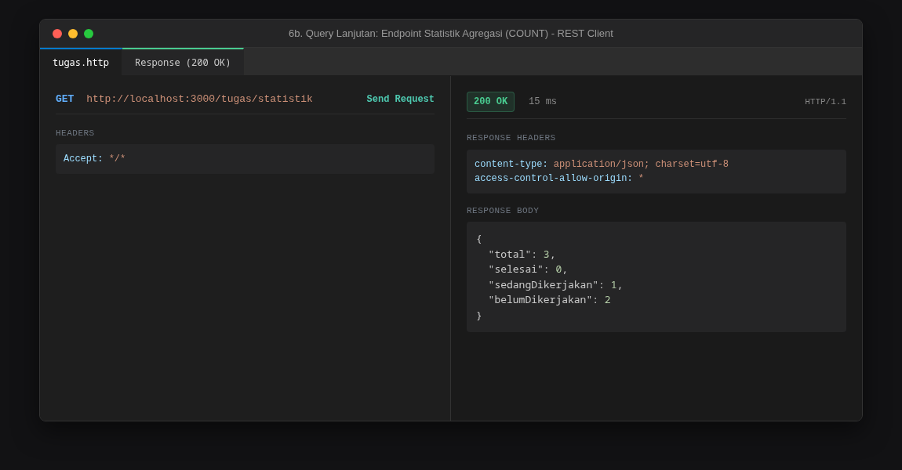

---

### Tahap 7: Tampilan Aplikasi Frontend

#### Tampilan Desktop
Tampilan antarmuka web pada layar desktop yang terhubung langsung dengan backend NestJS dan database PostgreSQL.

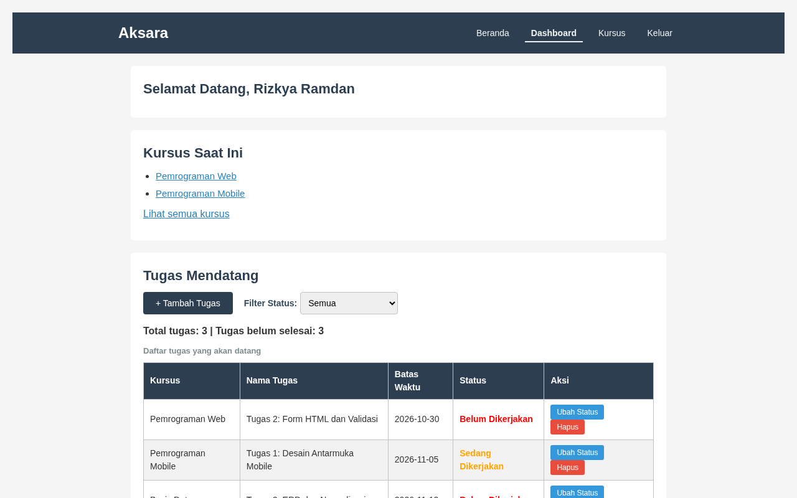

#### Tampilan Mobile
Tampilan antarmuka responsif pada perangkat mobile.

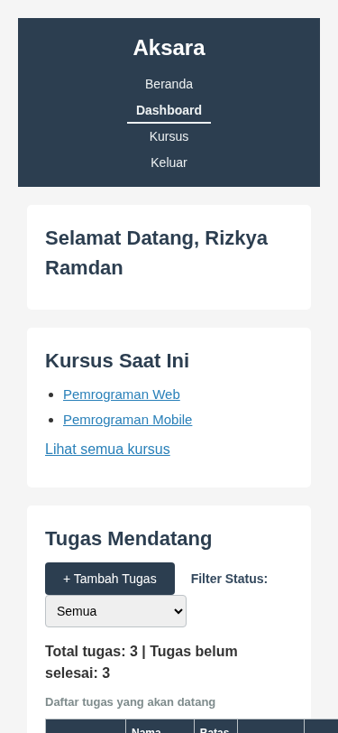

---

## 3. Cara Menjalankan Aplikasi

### 1. Database (PostgreSQL)
Pastikan service PostgreSQL aktif, lalu buat database:
```bash
psql -U postgres -c "CREATE DATABASE aksara_db;"
```

### 2. Backend (NestJS + Prisma)
```bash
cd backend
npm install
npx prisma migrate dev
npx prisma db seed
npm run start:dev
```
Backend berjalan pada: `http://localhost:3000`

### 3. Frontend (React + Vite)
```bash
npm install
npm run dev
```
Frontend berjalan pada: `http://localhost:5173`
